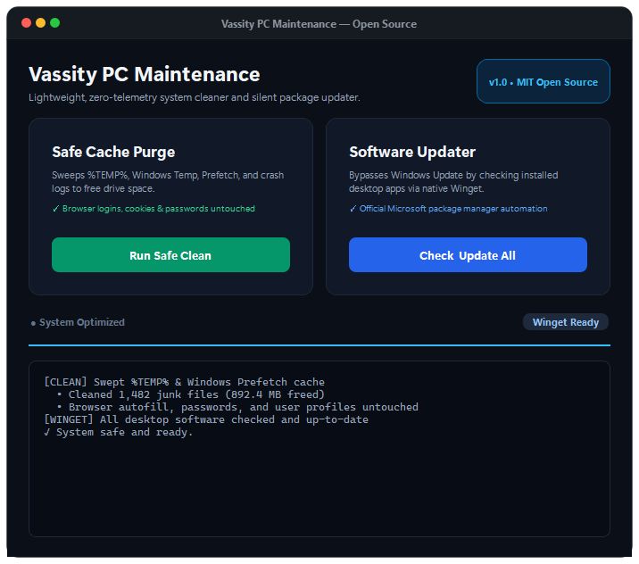

# ⚡ Vassity PC Maintenance & Software Updater

> A lightweight, sovereign open-source system maintenance utility built with Python & PySide6. Clean system caches safely and update all installed applications with zero browser tampering across **Windows, macOS, and Linux**.

[](https://github.com/777Business/PC-Cleaner-Updater/releases/latest)
[](LICENSE)
[]()
[]()

<p align="center">
  
</p>

---

## 💡 Why Vassity Cleaner?

Most third-party PC cleaners are bloated, push intrusive ads, or dangerously wipe browser databases—deleting your saved autofill logins, cookies, and pinned sessions.

**Vassity PC Cleaner is built on three core principles:**
1. **Safety First**: Only purges true operating system temp dumps and system caches. It **never touches** browser profiles, autofill, passwords, or personal documents.
2. **Native Package Updates**: Bypasses slow OS updaters by tapping into native package managers (**Microsoft Winget** on Windows, **Homebrew** on macOS, **Flatpak & APT/DNF/Pacman** on Linux) to update all desktop apps silently in a clean, discreet queue.
3. **1-Click In-App Auto-Updates**: Automatically checks GitHub Releases on startup. When a new release is published, a sleek in-app notification lets users upgrade and relaunch with a single click.

---

## ✨ Features

- 🧹 **Safe Temporary Cache Purge (Cross-Platform)**:
  - **Windows**: Sweeps `%TEMP%`, `C:\Windows\Temp`, Prefetch, and crash logs.
  - **macOS**: Purges `~/Library/Caches`, temporary system dumps, and crash logs.
  - **Linux**: Sweeps `/tmp`, `/var/tmp`, `~/.cache`, and system trash.
  - *Zero browser history, cookie, or password deletion.*
- 🚀 **Automated Software Updater**:
  - **Windows**: Microsoft Windows Package Manager (`winget`).
  - **macOS**: Native Homebrew (`brew`) automation.
  - **Linux**: Universal Flatpak (`flatpak`) updates and system package checking.
  - Discreet queue badge (`Queue: 1/4`) and micro progress tracker.
- ⚡ **1-Click Self-Updating Engine**:
  - Asynchronously queries GitHub Releases on startup.
  - Shows top banner with version number and changelog button when an update is available.
  - Automatically downloads and swaps the binary, relaunching seamlessly.
- 🎨 **Modern Dark UI**:
  - Built with PySide6 (Qt) in a responsive, clean dark aesthetic.
  - Real-time live log console.

---

## 🚀 Quick Start (Pre-built Binaries)

Download the pre-built version for your operating system from [Releases](https://github.com/777Business/PC-Cleaner-Updater/releases/latest):
* **Windows**: `VassityCleaner.exe`
* **Linux**: `VassityCleaner-Linux`
* **macOS**: `VassityCleaner-macOS`

Double-click to launch (no Python installation or command line required).

---

## 🛠️ Running from Source

If you prefer running from Python source or contributing:

```bash
# Clone the repository
git clone https://github.com/777Business/PC-Cleaner-Updater.git
cd PC-Cleaner-Updater

# Install requirements
pip install PySide6

# Run the app
python app.py
```

### Building Binaries Yourself

```bash
pip install pyinstaller

# Windows
python -m PyInstaller VassityCleaner.spec

# Linux
pyinstaller --noconsole --onefile --name="VassityCleaner-Linux" app.py

# macOS
pyinstaller --noconsole --onefile --windowed --name="VassityCleaner-macOS" app.py
```

---

## 🔒 Privacy & Safety Guarantee

- **No Telemetry**: No background telemetry, tracking, or network calls to external analytic servers.
- **No Registry Tweaks**: Does not modify Windows registry or delete critical system binaries.
- **Open Source**: 100% transparent codebase under the MIT License.

---

## 📄 License

Distributed under the [MIT License](LICENSE). Copyright (c) 2026 Vassity.
